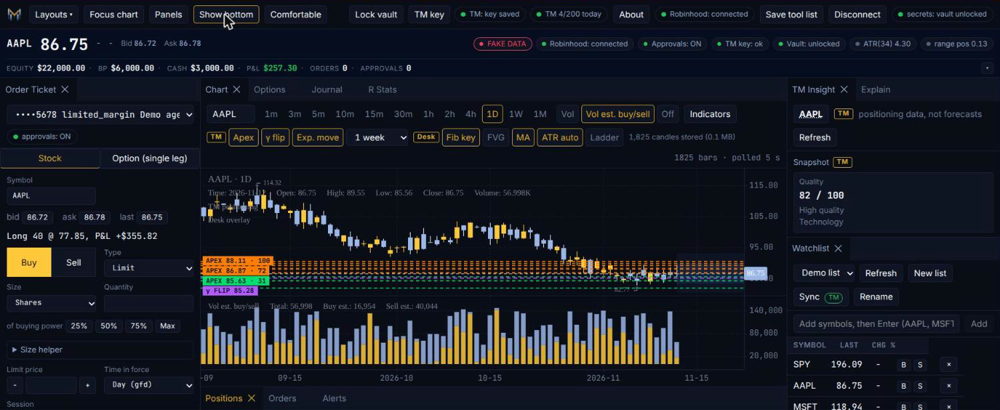

# TraderMatrix Desktop

**A native desk for options sellers: Robinhood as the broker, TraderMatrix positioning on the chart, an AI that explains the screen and never touches an order.**

TraderMatrix Desktop is a Linux-first Tauri app that puts your Robinhood account, live charts, option chains and TraderMatrix's positioning data (Apex levels, gamma flip, expected move) in one multi-panel workspace. It exists because premium sellers need to see where the dealers are leaning, how far the market is priced to move, and whether a strike sits outside that move, without alt-tabbing across five sites. Everything runs on your machine: keys sit in an encrypted local vault, candles and chat history sit in local SQLite, and the only network calls go to the services you connect.

Works with the Robinhood MCP. Not affiliated with or endorsed by Robinhood.

> **This app can place real orders with real money.** Read [Safety](#safety) before you connect an account.

---

## Feature tour

### Chart with TraderMatrix positioning overlays
KLineChart-based candles on 12 timeframes (1m to 1M). Toggle **Apex levels**, the **gamma flip** and **expected-move bands** on top of price. They are positioning maps, not price targets, and they never stretch the y-axis. Robinhood only serves fixed bar intervals, so 3m, 15m and 2h are aggregated client-side.

### Volume with estimated buy/sell
A volume pane that splits each bar into estimated buy and sell volume. "Estimated" is in the label on purpose: the split is derived from bar structure, not tape data.

### Option charts
Click a contract and the chart switches to that option's own price history.

### Desk overlay: fib, MA, ATR, FVG
A native overlay with per-timeframe parameters: key or full Fibonacci retracements off the higher-timeframe swing, SMA 20/50/200, a Wilder ATR band for an open position, and fair value gaps. Click cycles a layer, shift-click solos it.

### Strike check for premium sellers
Open an option ticket and get a verdict on the strike: distance to the expected move, nearest gamma wall, days to expiry, earnings inside the window. The output is a labelled read of the data (`protected`, and its siblings), not a trade recommendation.

### Level ladder
A right-gutter ladder that stacks every level on the chart (TraderMatrix levels, gamma flip, fibs, ATR, MAs) in price order, so you can read the map without hunting lines across the pane.

### One-click ticket fills
Positions get **Close**, **Mkt** and **Add**. Watchlist rows get **B** and **S**. Orders get **Cancel and edit**. Every one of them only fills the order ticket. None of them places anything. A fill expires after 30 seconds and never overwrites a ticket that is mid-review or mid-flight.

### Order ticket: review, then place
Equity and single-leg option orders go through a Rust-side review (`review_*`), then an explicit Place on that exact review. See [Safety](#safety) and [docs/ARCHITECTURE.md](docs/ARCHITECTURE.md). If Robinhood's trade approvals are on for your MCP account, Place returns an approval and nothing is submitted until you approve it in the Robinhood app. The ticket handles both states.

### Watchlists and TraderMatrix sync
Robinhood custom watchlists with add, remove, create. The **Sync** dialog diffs a TraderMatrix list against a Robinhood list, shows what can and cannot cross over (with reasons), and applies in either direction. Sync only adds. It never removes a symbol on either side, and a test fails if a remove call ever shows up.

### Journal
Realized P&L and trade history from Robinhood, with local notes attached per trade. Notes live in a local SQLite table and never leave the machine. CSV export neutralizes spreadsheet formula injection (cells starting with `=`, `+`, `-`, `@` get a leading quote).

### Chart alerts
Right-click the chart (or press Alt+A) to set an alert at a price. Alert lines sit on the chart with a bell, and you can drag them. You can also alert by level: a cross or touch of an Apex level, the gamma flip, an expected-move edge, a fib, an ATR band or a moving average. Alerts can fire a toast, a sound and an OS notification, and the app keeps a local history of what fired. They are informational only. An alert never places, reviews, cancels or fills an order, and evaluating one makes no network calls of its own: it only looks at data the app already polls. A single guarded database update decides whether an alert fires, so two panes polling at once produce one event.

### R tools
R is the dollar amount a trade was planned to lose. Set it on a trade and the app does the arithmetic around it.

- **Size helper.** On the ticket, give it a risk (a percent of account equity, or dollars) and a stop. It computes a quantity and fills the quantity field. It fills nothing else and places nothing.
- **Journal R column.** Realized P&L divided by planned risk, per trade. Robinhood's P&L feed has no order id, so the app suggests which review matches which trade and you confirm it. Nothing links automatically.
- **R-stats panel.** Expectancy in R, win rate, average win and loss in R, and SQN once you have 30 trades.
- **Heat.** Planned R summed across open positions, as a percent of equity.

All of it is informational. There are no caps and no blocks.

### Quota-aware TraderMatrix client
TraderMatrix publishes 12 tool calls per minute per account and a daily budget (25 on the free preview, 200 on Premium). The app runs under the same limits as everyone else: a sliding 60 second window held at 10 calls per minute (soft, under TM's 12), a Premium daily default of 200, and a header chip showing calls used today. The symbol on screen gets priority over watchlist sync and alert polling, and low-priority calls are dropped when under 20% of the day is left. If TM says slow down or the daily limit is reached, the gate backs off instead of retrying.

### Arya, the explain-only chat
Arya reads a digest of what is on your screen (chart numbers, levels, your positions if you tick the box) and explains it in plain language. Use the **Ask about this** menus on a candle, level, ladder rung, position, strike or trade.

- **Grounded.** Every number in a reply is checked against the digest. A number that is not in your data gets a dotted underline.
- **Explain-only.** A linter flags prescriptive language, the pane carries no order vocabulary, and the chat has no tool access. Arya never places and never suggests an order.
- **Lenses.** Pick up to two reference cards per question (chart, options, posture, sizing and R). A lens is short fixed text compiled into the app that defines terms and says how to read the digest. It is never fetched, never executed and never supplied by the webview.
- **Bring your own model:** OpenRouter, OpenAI, Anthropic, Venice, Ollama, LM Studio, any custom OpenAI-compatible endpoint, a self-hosted Hermes agent, and, as an opt-in advanced option, the Claude app already installed on your computer.
- **Found on this computer.** The provider setup lists agent CLIs it detects on your PATH. Detection is detect-only for most of them: a CLI with no vetted recipe is shown and can never be run. `claude` is the one usable recipe (text only, every tool disabled, prompt on stdin). In a public build the CLI cards are hidden unless you turn on Advanced.
- **Sign in with OpenRouter.** Log in through your browser instead of pasting a key; the resulting key goes straight into the vault.
- Streaming, a token and cost meter with budgets, per-symbol threads, secret redaction on everything that leaves the box.

### Local-first
SQLite for layouts, settings, journal notes, chat threads and candles. Candles you load are stored locally and the toolbar shows the running count. Dockview panels you can rearrange; layouts autosave.

---

## Screenshot gallery

Images live in `docs/screenshots/`. Every shot here uses the built-in sample-data backend: no real account, no real prices, no real orders. See [docs/screenshots/README.md](docs/screenshots/README.md) for how each one is captured.


*The full desk: order ticket on the left, chart in the middle with Options, Journal and R Stats tabs, TraderMatrix insight and watchlist on the right. The bottom panel (positions, orders, alerts) collapses with one click to give the chart the room.*


*Candles with Apex levels, gamma flip, expected-move band and estimated buy/sell volume.*


*Desk overlay layers on: key fibs, moving averages and an ATR band.*


*Every level on the chart stacked in price order down the right edge.*


*Strike check on an option ticket: expected move, wall, days to expiry, earnings.*


*One click on Close or Add fills the ticket. Nothing is placed.*


*Arya answers from your screen's data; a number not in the data is underlined.*


*Pick a model provider: hosted, local, self-hosted or an installed Claude.*


*Realized P&L, trade history and local notes.*

---

## Bring your own keys

There is no TraderMatrix Desktop server and no account with us. You bring three things, all optional except the first:

| What | How you give it | Used for |
|---|---|---|
| **Robinhood** | OAuth 2.1 login in your browser (PKCE, loopback redirect). You never type a Robinhood password into this app. | Accounts, quotes, bars, option chains, positions, orders, watchlists, P&L |
| **TraderMatrix API key** | Paste into the TM key panel (a `td_live_...` key from your TraderMatrix account) | Apex levels, gamma flip, expected move, IV rank, snapshot, watchlist sync |
| **An LLM key** (optional) | Sign in with OpenRouter, paste a key into a provider card (OpenRouter, OpenAI, Anthropic, Venice and others), or use a local model or an installed CLI with no key at all | Arya |

### About the TraderMatrix key
Get a key at <https://www.tradermatrix.pro/settings?tab=developer>. TraderMatrix publishes these limits for its MCP: free accounts get a 25-call-per-day preview (lists cut to the first 3 items), Premium gets 200 tool calls per day, and every tier is capped at 12 tool calls per minute per account. A symbol switch costs about 4 calls and the Apex overlay refreshes on a timer, so a free or Premium day can go fast when you flip through many symbols. TraderMatrix returns a derived layer only (levels, flow scores, IV rank, gamma and Apex data). It never returns per-contract quotes or raw option chains, so quotes and chains in this app come from Robinhood. The app enforces these limits itself: see Quota-aware TraderMatrix client above.

To point any other AI agent at the same TraderMatrix MCP, use the canonical skill: <https://www.tradermatrix.pro/skills/tradermatrix/SKILL.md>.

All of it lives in an encrypted local vault: a passphrase run through Argon2id, sealed with XChaCha20-Poly1305, one file in the app data directory, unlocked once per launch (the OS keychain is preferred when one exists). The webview never receives a stored secret; there is no command that returns one. Nothing is sent anywhere except the services above, and tokens and keys are scrubbed from error text and logs.

---

## Safety

- **Real orders are real money.** Place on a ticket sends a live order to your Robinhood account.
- **No order caps, by design.** There is no size limit, no kill switch and no arm step in this app. That is a decision, not an oversight. If you want a guardrail, the Robinhood side has one: see approvals below. A compromised machine or webview is a compromise of your ability to trade; treat the host accordingly.
- **The webview never builds a tool call.** It sends a validated order intent; Rust re-validates it strictly, calls the review tool, stores the review, and places only that exact review once. `unknown` outcomes are never auto-retried; an explicit retry re-sends the same reference id so Robinhood de-duplicates.
- **Approvals live in Robinhood.** The per-account trade-approval toggle is a Robinhood setting (off by default for MCP accounts). With it on, Place returns an approval and nothing is placed until you approve it in the Robinhood app. This app handles both states.
- **The AI never places or suggests orders.** Arya is explain-only and has no tools.
- **Not financial advice.** Overlays are positioning maps, not targets. Strike check is a labelled read of data. You own every order you place.
- **Not affiliated with or endorsed by Robinhood.** This app works with the Robinhood MCP. "Robinhood" is a trademark of Robinhood Markets, Inc.

Report vulnerabilities per [SECURITY.md](SECURITY.md).

---

## Install and run

**What is verified:** Linux, built with webkit2gtk-4.1 on Debian 12 and run on Debian 13. macOS and Windows are not built or tested. Treat them as unsupported.

Prerequisites (Linux):

- Rust stable (via rustup)
- Node 22 or newer and pnpm 10
- Tauri 2 system libraries: `libwebkit2gtk-4.1-dev`, `build-essential`, `libssl-dev`, `libxdo-dev`, `libayatana-appindicator3-dev`, `librsvg2-dev`, `curl`, `file`
- Plenty of RAM for the Rust build. It is fine on 6 GB with `CARGO_BUILD_JOBS=2` if nothing else is hungry.

```bash
git clone https://github.com/tradernetwork/tradermatrix-desktop
cd tradermatrix-desktop

# tests (webview, script runtime, Rust core)
(cd packages/script && pnpm install && pnpm test)
(cd apps/desktop && pnpm install && pnpm test && pnpm exec tsc --noEmit)
(cd apps/desktop/src-tauri && cargo test && cargo test --features public-build --lib)

# release binary (no installer bundle)
cd apps/desktop
pnpm exec tauri build --no-bundle    # first build takes minutes
./src-tauri/target/release/tradermatrix-desktop
```

First launch: create the vault passphrase, Connect Robinhood (browser login), optionally paste a TraderMatrix key, optionally set up a model provider for Arya.

Test counts at this commit: **1389** webview tests (vitest, 104 files), **232** script-runtime tests, **539** Rust tests (also 539 with `--features public-build`), `cargo clippy --all-targets -- -D warnings` clean, `tsc --noEmit` clean. Every test runs against local mock servers. None touches Robinhood, TraderMatrix or any LLM provider.

`scripts/smoke-desktop.sh [binary]` launches the release binary and checks it stays up.

---

## Roadmap (planned, not built)

- **ACP.** Talk to local agent CLIs over the Agent Client Protocol instead of one-shot text recipes.
- **TraderMatrix-served lens catalog.** Lens cards served by TraderMatrix, if and when an authored, stable format exists.
- **More LLM providers.** Additional hosted and local providers for Arya, plus first-class key handling for them.

Planned means planned. If it is not in the feature tour above, it does not exist yet.

## Contributing

Read [CONTRIBUTING.md](CONTRIBUTING.md). Short version: test first, no network in tests, never place a real order from a test, and the chat stays explain-only. Bug reports use the template in `.github/ISSUE_TEMPLATE/`; never paste keys.

## License

MIT for the code: see [LICENSE](LICENSE). The TraderMatrix brand assets (marks, wordmark, Arya stills, background art) in `apps/desktop/src/assets/brand/` and the generated app icons are all rights reserved, are **not** MIT, and are covered by `apps/desktop/src/assets/brand/LICENSE-BRAND.txt`. Fork it? Swap them for your own. Third-party software and fonts are listed in [THIRD_PARTY_LICENSES.md](THIRD_PARTY_LICENSES.md) and [NOTICE](NOTICE) (KLineChart is Apache-2.0, bundled fonts are SIL OFL 1.1, a few Rust crates are MPL-2.0).
